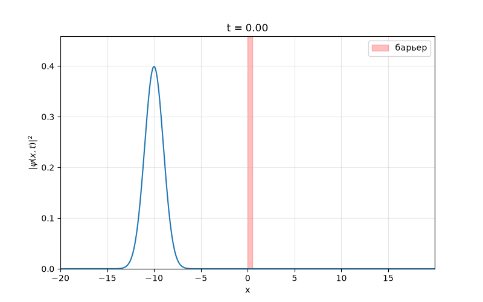
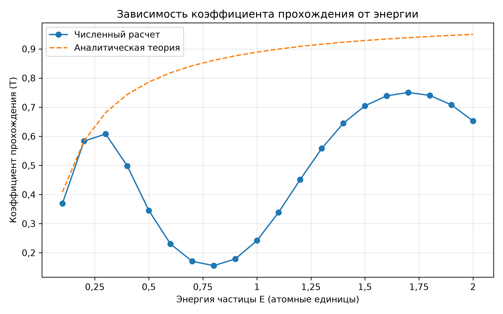

# Туннельный эффект в одномерном нестационарном уравнении Шрёдингера

**Автор:** Бондарева Дарья Сергеевна  
**Группа:** Б26-222, НИЯУ МИФИ (ЛаПлаз)  
**Дисциплина:** Программирование на Python

---

## О проекте

Программа представляет собой численное решение одномерного нестационарного уравнения Шрёдингера для потенциального барьера. Моделируется эволюция гауссова волнового пакета, налетающего на прямоугольный барьер. 

Расчет производится методом расщепления оператора (split-operator method) с использованием быстрого преобразования Фурье (FFT) для кинетической энергии. Программа позволяет вычислять коэффициенты прохождения (\(T\)) и отражения (\(R\)), а также визуализировать процесс туннелирования.

### Визуализация процесса
<div align="center">
  
  <p><i>Анимация эволюции плотности вероятности |ψ(x,t)|² при взаимодействии с барьером</i></p>
</div>

---

## Ключевые возможности

*   **Численное моделирование:** Решение уравнения Шрёдингера с сохранением нормы на каждом шаге по времени.
*   **Объектно-ориентированная архитектура:** Код разделен на независимые модули (потенциал, пакет, солвер, визуализатор, менеджер данных).
*   **Интерактивный режим:** Возможность изменять высоту (\(V_0\)), ширину (\(a\)) барьера и энергию (\(E\)) в реальном времени с помощью слайдеров.
*   **Исследование зависимостей:** Автоматическое построение графиков \(T(E)\), \(T(a)\), \(T(V_0)\) и проверка экспоненциального закона туннелирования.
*   **Тестирование:** Наличие юнит-тестов (Pytest) для проверки корректности физики и алгоритмов.

---

## Исследование

В рамках проекта проведено исследование зависимости коэффициента прохождения от параметров системы.

<div align="center">
  
  <p><i>Зависимость коэффициента прохождения T от энергии E. Синяя линия — численный расчет, оранжевый пунктир — аналитическая теория.</i></p>
</div>

---

## Установка и запуск

1. Склонируйте репозиторий:
```bash
git clone https://github.com/Rainer098/tunneling-effect.git
cd tunneling-effect